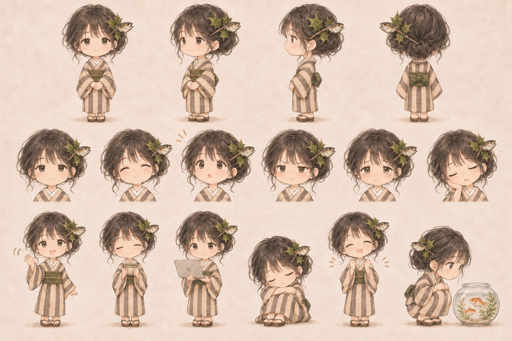

# 20261116Person-IPAtlas

个人 IP 形象库，收录角色基准、系列插画、透明表情、带字扩展和软件小图素材，并保留对应提示词、资产清单与历史版本。

角色以自然碎刘海、低后发髻、短鱼头与柊叶发饰、暖米和灰褐条纹浴衣为主要识别特征，整体以低饱和水彩为主。

## 内容与入口

| 内容 | 数量 | 入口 |
| --- | ---: | --- |
| 当前角色基准 | 5张 | [00-角色基准](IP形象图像/00-角色基准/) |
| 原系列单图 | 461张，33个系列 | [系列目录](#原系列导航) |
| 系列总览与封面 | 28张 | 各系列目录内，含27张总览和1张故事封面 |
| 可选带字扩展 | 104张 | [带字扩展](IP形象图像/可选带字扩展/) |
| 软件素材设计 | 82款（原46款＋新图标30款＋新职业人物6款） | [软件素材](#软件素材) |
| 软件尺寸导出 | 245张PNG，另2份ICO | 各软件系列的数字尺寸目录及[应用图标](IP形象图像/软件小图素材/50-应用图标/) |
| 兼容资源 | 22张 | [兼容资源包](IP形象图像/软件小图素材/专属桌面装饰包/) |

尺寸导出、分组角落选集、应用图标、扩展分组复用的24张人物和兼容资源不重复计为新设计。51系列新增的30款物件图标与6款职业人物计入设计总数；原46款保留。历史版本、验收预览和辅助检查图不计入上述设计数量。

[使用指南](docs/使用指南.md) · [提示词使用入口](IP形象提示词/00-总览与使用方法.md) · [角色设定](IP形象提示词/01-角色基准设定.md) · [原始角色参考](参考图/原始素材/i-kimono.jpg)

## 下载与使用

```bash
git clone https://github.com/pingangogogo/20261116Person-IPAtlas.git "20261116个人IP形象库"
```

完整素材库约1.46 GiB，也可以先在线浏览对应系列再选择图片。清单路径均相对于仓库根目录，不依赖原桌面软件项目或本机生成缓存。

## 素材预览

当前Q版角色基准：



旅行与风景系列总览：


## 原系列导航

| 主题 | 系列 |
| --- | --- |
| 时间与自然 | [10 四季](IP形象图像/10-四季/) · [11 二十四节气](IP形象图像/11-二十四节气/) · [12 月历十二个月](IP形象图像/12-月历十二个月/) · [13 一周七天](IP形象图像/13-一周七天/) · [14 一日十二时辰](IP形象图像/14-一日十二时辰/) · [15 中国传统节日](IP形象图像/15-中国传统节日/) · [16 和风岁时](IP形象图像/16-和风岁时/) · [17 天气](IP形象图像/17-天气/) |
| 表情与日常 | [18 情绪表情包](IP形象图像/18-情绪表情包/) · [19 问候与祝福](IP形象图像/19-问候与祝福/) · [20 工作与电脑](IP形象图像/20-工作与电脑/) · [21 学习与阅读](IP形象图像/21-学习与阅读/) · [22 饮食与茶](IP形象图像/22-饮食与茶/) · [23 居家日常](IP形象图像/23-居家日常/) · [24 兴趣爱好](IP形象图像/24-兴趣爱好/) · [25 运动与户外](IP形象图像/25-运动与户外/) · [26 旅行与风景](IP形象图像/26-旅行与风景/) |
| 造型与表现 | [27 和风换装](IP形象图像/27-和风换装/) · [28 现代换装](IP形象图像/28-现代换装/) · [29 中式与世界换装](IP形象图像/29-中式与世界换装/) · [30 头饰变化](IP形象图像/30-头饰变化/) · [31 色彩主题](IP形象图像/31-色彩主题/) · [32 姿态动作库](IP形象图像/32-姿态动作库/) · [33 镜头与构图](IP形象图像/33-镜头与构图/) · [34 画风与材质](IP形象图像/34-画风与材质/) · [35 年龄与幻想](IP形象图像/35-年龄与幻想/) |
| 伙伴与故事 | [36 伙伴与小物](IP形象图像/36-伙伴与小物/) · [37 十二生肖](IP形象图像/37-十二生肖/) · [38 十二星座](IP形象图像/38-十二星座/) · [39 四格小故事](IP形象图像/39-四格小故事/) |
| 应用与物料 | [40 界面与壁纸素材](IP形象图像/40-界面与壁纸素材/) · [41 周边物料](IP形象图像/41-周边物料/) · [42 纹样与边框](IP形象图像/42-纹样与边框/) |

先用总览选主题，再取对应独立PNG。图片保留实际原生尺寸；透明素材、完整场景和壁纸按各自用途区分。

## 带字扩展与月历

[可选带字扩展](IP形象图像/可选带字扩展/)包含24张节气、12张月历、7张星期、11张传统节日、32张情绪表情及18张问候祝福，共104张。无字原图独立保留。

月历为**2027年公历，周日开始**。需要其他年份时，应重新排历；月份无字插画可继续用于其他排版。

## 软件素材

| 系列 | 原稿或来源 | 导出尺寸（像素） |
| --- | ---: | --- |
| [43 分组角色](IP形象图像/软件小图素材/43-分组角色/) | 11张 | 128、256 |
| [44 分组图标](IP形象图像/软件小图素材/44-分组图标/) | 11张 | 24、32、48、64、128 |
| [45 软件空状态](IP形象图像/软件小图素材/45-软件空状态/) | 6张 | 128、256 |
| [46 操作反馈](IP形象图像/软件小图素材/46-操作反馈/) | 6张 | 128、256 |
| [47 操作引导](IP形象图像/软件小图素材/47-操作引导/) | 6张 | 128、256 |
| [48 窗口小助手](IP形象图像/软件小图素材/48-窗口小助手/) | 6张 | 128、256 |
| [49 分组角落](IP形象图像/软件小图素材/49-分组角落/) | 既有透明角色选集40张 | 480 |
| [50 应用图标](IP形象图像/软件小图素材/50-应用图标/) | 既有物件图标2套 | 16、20、24、32、40、48、64、96、128、256，另ICO |
| [51 扩展分组](IP形象图像/软件小图素材/51-扩展分组/) | 新图标30款＋新职业人物6款＋既有透明人物24张 | 图标128、右上人物400 |

`原稿/`保存生成原图，数字目录保存实际像素导出。43～48系列的逐张提示词保存在[软件素材生成任务.json](IP形象图像/软件小图素材/软件素材生成任务.json)的`tasks[].prompt`中。可查看[物件图标的24、32、48像素浅深背景预览](IP形象图像/软件小图素材/验收预览/44-实际尺寸-浅深底.png)。

43与44对应自研、办公、开发、科研、通讯、影音、系统、项目、资料、事务、待整理11个分组。兼容资源包提供256像素的`s-*.png`角色装饰和128像素的`i-*.png`物件图标，映射见[资源映射.json](IP形象图像/软件小图素材/专属桌面装饰包/资源映射.json)。

49提供`f-group-01`至`f-group-40`四十张独立角落图，前10张对应默认分组，后30张供新增分组分配，来源及校验值见[资源映射](IP形象图像/软件小图素材/49-分组角落/资源映射.json)，选图见[40张预览](IP形象图像/软件小图素材/49-分组角落/选集预览.png)。50为专属桌面提供待整理物件图标，为个人工具箱提供绿色齿轮与扳手；每套PNG与ICO来自同一母图，见[实际尺寸预览](IP形象图像/软件小图素材/50-应用图标/实际尺寸预览.png)及[资源映射](IP形象图像/软件小图素材/50-应用图标/资源映射.json)。

51提供`extra-01`至`extra-30`共30套分类图案，每套含128像素小图标和400像素右上人物。前6套依次对应工程、设计、远程、网络、投研、游戏，配套人物为新生成的职业角色；后24套备用，人物复用库内不同透明角色图。30款新图标由OpenAI生图工具参考44系列生成，图标与职业人物的原始atlas保存在`51-扩展分组/原稿/`；见[资源映射](IP形象图像/软件小图素材/51-扩展分组/资源映射.json)、[图标预览](IP形象图像/软件小图素材/51-扩展分组/图标预览.png)和[人物预览](IP形象图像/软件小图素材/51-扩展分组/人物预览.png)。软件尺寸PNG为原185张加51的60张，共245张，另有2份ICO；复用人物不增加设计数。

素材先存入本库并记录映射，再复制到软件资源。专属桌面为旧版未设图案的分组及新分类分配未占用的整套图，资源名持久保存，改名或调序不换图，用尽后留空。升级补图保留自选图名及同名PNG/JPG/JPEG；补齐后用户删除的图不再自动补回。

## 版本与清单

[历史版本](IP形象图像/历史版本/)用于追溯设定变化。继续生成时使用当前基准，历史图与历史提示词不作为生成参考。

资产索引见[原系列清单](IP形象图像/生成任务.json)、[总览清单](IP形象图像/系列总览任务.json)、[带字扩展清单](IP形象图像/可选带字扩展任务.json)和[软件素材清单](IP形象图像/软件小图素材/软件素材生成任务.json)。清单内文件路径以仓库根目录为起点，尺寸和SHA256用于文件核对。

## 来源与许可

见[来源与许可](docs/来源与许可.md)。
